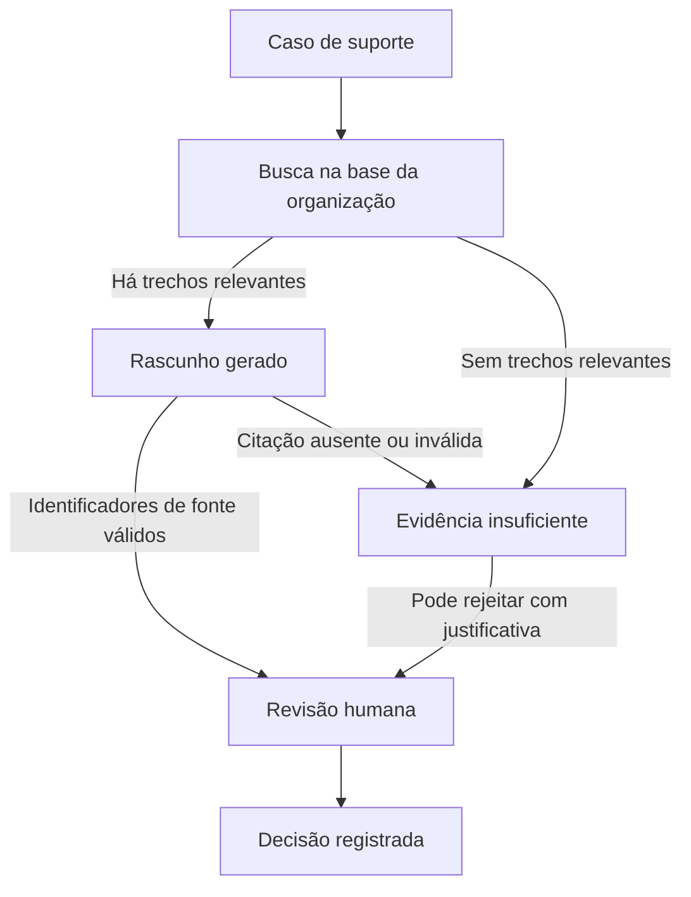

# Arquitetura

[Voltar ao projeto](../README.md) · [Fazer o primeiro caso](first-case.md)

O fluxo combina recuperação de trechos, geração de uma proposta e decisão humana. Cada busca usa a organização autenticada.

## Roteiro de leitura

| Etapa | Comece aqui | Repare em |
| --- | --- | --- |
| Receber o caso | [CaseService.java](../backend/src/main/java/dev/erikamendes/support/cases/application/CaseService.java) | O caso e seu primeiro evento são gravados juntos. |
| Indexar e recuperar fontes | [KnowledgeService.java](../backend/src/main/java/dev/erikamendes/support/knowledge/application/KnowledgeService.java) e [DocumentRepository.java](../backend/src/main/java/dev/erikamendes/support/knowledge/infrastructure/DocumentRepository.java) | A busca filtra organização e modelo de embeddings antes de ranquear os trechos. |
| Preparar o rascunho | [ProposalService.java](../backend/src/main/java/dev/erikamendes/support/proposals/application/ProposalService.java) | O backend verifica as citações e preserva cópias dos trechos usados. |
| Registrar a decisão | [ReviewService.java](../backend/src/main/java/dev/erikamendes/support/review/application/ReviewService.java) e [migração da revisão](../backend/src/main/resources/db/migration/V5__human_reviews.sql) | O serviço e o banco garantem uma decisão por proposta. |

## Módulos e decisões

O backend parte de um monólito modular. Cada capacidade tem suas próprias regras, casos de uso, API e adaptadores. `identity` oferece a autenticação de demonstração e o contexto da organização; `cases` contém o fluxo de casos, separados entre `domain`, `application`, `infrastructure` e `api`.

| Módulo | Situação | Responsabilidade |
| --- | --- | --- |
| `identity` | Demonstração | Duas contas e o contexto da organização autenticada |
| `cases` | Implementado | Casos, transições de estado, consulta e histórico |
| `knowledge` | Implementado | Documentos de texto, trechos, embeddings e busca |
| `proposals` | Implementado | Recuperação por organização, geração, validação e persistência de rascunhos |
| `review` | Implementado | Aprovação, edição, rejeição e histórico imutável das decisões |
| `audit` | Parcial no módulo `review` | As decisões são preservadas em `proposal_reviews`; auditoria abrangente permanece no roadmap |

As regras de estado ficam no domínio; as transações são coordenadas na camada de aplicação; os repositórios usam JDBC com consultas explícitas. Um caso e seu evento são gravados na mesma transação. A alteração de estado bloqueia a linha do caso até registrar o evento. As consultas e alterações incluem a organização autenticada. As chaves estrangeiras compostas dos eventos e trechos impedem associá-los a registros de outra organização.

Na ingestão, o texto é dividido em trechos de até 900 caracteres Unicode, com sobreposição de aproximadamente 120. Os embeddings são gerados **antes** da transação; documento e trechos são inseridos juntos, de modo que uma falha do modelo não deixe um documento parcial visível. O hash SHA-256 evita duplicar o mesmo conteúdo para a mesma organização e modelo. A busca filtra a organização e o modelo antes de calcular a distância de cosseno no pgvector; a primeira versão usa ranking exato para priorizar a consistência dos resultados. Índices aproximados como HNSW serão avaliados com volume e métricas de recall.

A geração busca até cinco trechos do modelo de embeddings atual e descarta os que estão abaixo da similaridade mínima configurada (`PROPOSAL_MIN_SIMILARITY`, padrão `0.55`). O limiar deve ser calibrado em um corpus representativo: similaridade de cosseno não é uma probabilidade de correção. O texto do caso e os documentos são incluídos no prompt como dados não confiáveis, sem ferramentas nem ações externas. A API exige ao menos uma referência válida no formato `[S1]` no texto da resposta e descarta uma resposta vazia, longa demais ou com referência desconhecida. Essa validação confere a existência da fonte. A pessoa revisora compara as afirmações do rascunho com os trechos. A chamada ao modelo ocorre antes da transação; antes de salvar, a aplicação bloqueia o caso, confere seu estado e verifica se os trechos recuperados ainda existem. As fontes usadas ficam como snapshots em `proposal_sources`, para permitir auditoria após exclusão de documentos. A proposta não altera o estado do caso.

Na revisão, a aplicação bloqueia primeiro o caso e depois a proposta na mesma transação, preservando uma ordem de bloqueios. A restrição `UNIQUE (proposal_id)` impede duas decisões para uma mesma proposta mesmo com solicitações simultâneas. A chave composta relaciona decisão, proposta, caso e organização; consultas usam o escopo da conta autenticada. Apenas rascunhos `READY_FOR_REVIEW` podem ser aprovados ou editados; uma proposta com evidência insuficiente pode ser rejeitada com justificativa. Editar exige justificativa, texto diferente e pelo menos uma citação a uma fonte já preservada. A checagem automatizada se limita aos identificadores das citações. Casos resolvidos ou encerrados não aceitam novas decisões. O estado do caso continua sendo alterado por uma operação separada.

## Tecnologias

| Parte | Tecnologia | Uso atual |
| --- | --- | --- |
| Backend | Java 17, Spring Boot 4.1.1 | API, segurança, regras de estado e transações |
| Frontend | Angular 21, TypeScript | Casos, documentos, propostas e revisão |
| Banco | PostgreSQL 17, pgvector 0.8.1 | Casos, eventos, documentos e busca vetorial |
| Embeddings | Ollama + `nomic-embed-text:v1.5` | Vetores locais com 768 dimensões |
| Migrações | Flyway | Esquema versionado |
| Build | Maven Wrapper, npm | Builds reproduzíveis |
| CI | GitHub Actions | Integração do backend e build do frontend |

O modelo de embeddings é configurável por ambiente, mas a coluna vetorial da fase 2 exige **768 dimensões**. O modelo de geração é `qwen3:1.7b` no Ollama e pode ser configurado por ambiente. Os testes de integração usam vetores fictícios e determinísticos para verificar armazenamento, ranking e isolamento; eles não medem qualidade semântica do Ollama.
